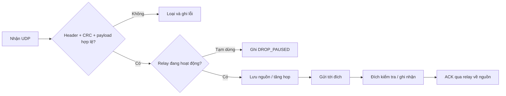

# Relay Lab 2.6 · ESP32 RelayBox

Mở hướng dẫn và kịch bản ở `Huong_dan_va_kich_ban_demo.pdf`. Phép đo ESP32 thật, nhật ký hai chiều và dữ liệu mô hình chạy trên board được kiểm tra khi chạy `python scripts/reproduce_final.py`.

# Relay Lab — chủ đề 3: Mạng truyền thông cộng tác Relay, D2D

Bản demo cục bộ dùng **hai Android và laptop**, không cần ESP32. Sản phẩm có ứng dụng Android native nhận/chuyển tiếp UDP, dashboard 3D Three.js, mô phỏng AF/DF, lưu log và phát lại. Phần LAN chạy được trên thiết bị hiện có; bản mô phỏng giải thích AF/DF ở tầng tín hiệu.

## Mở demo trên laptop này

1. Chạy `START_LAB.cmd`. Môi trường và APK đã được chuẩn bị trong thư mục này.
2. Mở **http://127.0.0.1:8765** trên laptop. Tab **Mô phỏng** chạy sẵn hoạt ảnh 3D; bấm **Chạy Monte Carlo** để tính theo các tham số đang chọn.
3. Tab **Thiết bị thật**: chọn Android relay đang online; đích **Laptop — pilot một Android** để chạy ngay với một điện thoại. Chọn **Qua relay**, 10 giây, 20 gói/giây, 128 bytes rồi **Bắt đầu đo**.
4. Khi chưa có điện thoại, chọn môi trường **LOOPBACK** để kiểm tra chương trình UDP hoàn toàn trên laptop. Nhãn LOOPBACK được lưu cùng kết quả.
5. Tab **Nhật ký** phát lại log từng phiên; liên kết JSON mở số liệu để đưa vào báo cáo.

Nếu chuyển sang máy khác, chạy `scripts/setup.ps1` trước. Cần Python 3.9+; các phiên bản đang chạy được ghi trong `requirements.txt` và `package-lock.json`. Tài nguyên Three.js được phục vụ từ `web/vendor`, không cần CDN trong buổi demo. Backend chỉ cần mạng LAN; không có bước publish lên Internet.

## Cắm Android thứ hai

Điện thoại đã thử trong phiên phát triển là **SM-G965F (Galaxy S9+), Android 10**. Mã ứng dụng hỗ trợ Android API 26+, APK debug phục vụ thí nghiệm nội bộ.

1. Cắm điện thoại thứ hai, bật USB debugging và tự chấp nhận kết nối máy tính nếu Android hỏi.
2. Chạy `adb devices -l` để lấy serial đúng máy.
3. Trong PowerShell tại thư mục demo, chạy:

```powershell
.\scripts\install_android.ps1 -Serial SERIAL_MAY_THU_HAI -Role sink
```

Script chỉ cài và mở package `vn.relaylab`. Điện thoại thứ nhất giữ vai trò **RELAY**; máy thứ hai là **DESTINATION**. Giữ ứng dụng ở phía trước và kết nối Wi-Fi. Khi máy đích xuất hiện trên dashboard, chọn nó trong ô **Thiết bị đích** rồi chạy lại.

Cũng có thể tải APK ở `http://IP_LAPTOP:8765/download/android`, cài thủ công, nhập IP laptop và chọn vai trò. Không cần đăng nhập, SIM, ảnh cá nhân hay dữ liệu riêng. USB dùng cài app và xuất log; UDP thử nghiệm đi qua Wi-Fi/LAN.

## Đường dữ liệu và giới hạn phát biểu

```text
Nguồn = laptop
  Direct ứng dụng: laptop ── UDP ──> Android đích
  Relay ứng dụng:  laptop ── UDP ──> Android relay ── UDP ──> Android đích

Pilot một điện thoại:
  laptop/source ── Wi-Fi/LAN ──> Android relay ── Wi-Fi/LAN ──> laptop/sink
```

Mạng hiện tại có router/AP và có thể có NAT giữa hai dải IP. Android gửi HELLO định kỳ từ socket dữ liệu để laptop biết endpoint trả về. Nếu hai Android cùng một mạng Wi-Fi, relay dùng IP nội bộ của đích. Nếu đặt hai Android ở các mạng khác nhau không định tuyến được cho nhau, cấu hình ba nút có thể không chạy; hãy đặt chúng vào cùng Wi-Fi trước.

**Direct ở đây nghĩa là không qua chương trình relay ở tầng ứng dụng.** Khung Wi-Fi vẫn có thể đi qua AP. Bản này không tạo nhóm Wi-Fi Direct, không thực hiện sidelink LTE/5G và không chứng minh tăng vùng phủ RF. Có thể chạy ứng dụng trên mạng hotspot do một thiết bị tạo nếu các máy truy cập được nhau, nhưng cần đo riêng cấu hình đó. D2D có thể trực tiếp giữa hai thiết bị; nút thứ ba là trường hợp relay-assisted D2D.

Demo Android là chuyển tiếp số theo nguyên lý nhận/kiểm tra/gửi lại; không phải AF analog. AF, fixed gain, variable gain được nghiên cứu trong mô phỏng. Không gọi UDP loss là BER hay outage lý thuyết. Không gọi phần cứng này là NOMA/SIC hoặc full-duplex cùng tần số.

## Dữ liệu test cụ thể

Nguồn tạo gói nhị phân: header **32 bytes** và payload **128/512/1024 bytes**. Header gồm magic RLY1, version, loại DATA/ACK/HELLO, hop count, flags, run_id, sequence, timestamp monotonic nguồn, payload length, reserved, CRC32 payload. CRC bảo vệ payload; header được kiểm tra cấu trúc, độ dài, run/seq và hop limit.

Byte payload thứ i là `(run_id + sequence*31 + i*17) mod 256`. Đích tính lại toàn bộ pattern và CRC. Đây là dữ liệu tổng hợp để đo truyền tin, được tạo có kiểm soát; không phải dữ liệu cảm biến đo thật. Một lượt 60 giây × 20 gói/giây tạo 1.200 sequence, tương đương 153.600 bytes payload ở cấu hình 128 bytes/gói. DATA không retry ở ứng dụng; Wi-Fi vẫn có retry/ACK ở MAC.

Android relay kiểm tra gói, lưu sự kiện, chuyển tiếp DATA và chuyển ACK ngược về nguồn. Đích loại gói sai, đếm sequence và trả ACK. Timestamp chỉ dùng tại nguồn để đo RTT; bản hiện tại dùng `time.perf_counter_ns()` là đồng hồ đơn điệu độ phân giải cao trên Windows. Không trừ hai đồng hồ khác máy. Các lượt phát triển cũ không có trường `source_clock` dùng timer độ phân giải thấp hơn, nên không gộp chúng để phân tích trễ. Thời gian xử lý relay bao gồm phần ghi log trước khi gọi gửi, không phải độ trễ thuần RF.

`results/run_ID/` chứa `config.json`, `events.jsonl`, `summary.json`. Các số trên dashboard:

- **Đã gửi:** số sequence nguồn thực sự đưa vào UDP socket.
- **Đích được xác nhận:** hợp các sequence có log nhận tại đích và có ACK hợp lệ tại nguồn, chia số gửi. Khi telemetry thiếu, tỷ lệ này có thể là cận dưới, chưa chứng minh số gói thực nhận chính xác.
- **Nhận tại đích:** số sequence duy nhất quan sát qua log của đích.
- **Goodput quan sát:** payload hữu ích tại đích chia cửa sổ phát cấu hình; có giai đoạn 2 giây chờ cuối để thu gói/ACK đến muộn.
- **RTT p95:** phân vị 95% trên những gói nhận được ACK; không tính các gói không ACK như có độ trễ bằng 0.

Telemetry gửi HTTP theo lô, có lưu log cục bộ và thử lại; đây là tải quản trị bổ sung. Nếu hàng đợi log Android quá tải, ứng dụng hiện bộ đếm. Phiên chỉ dừng sớm không dùng để kết luận throughput đầy đủ. Dừng relay có chủ đích chứng minh đường đi, không phải lỗi sóng tự nhiên.

## Mô phỏng và hướng mở rộng

`sim/model.py`: SISO, fading Rayleigh độc lập giữa các chặng, nhiễu AWGN, HD hai khe bằng nhau. Direct dùng cả khung. Gộp tín hiệu trực tiếp với tín hiệu relay chưa được mô hình hóa. Gain kênh công suất lấy mẫu exponential, tương đương bình phương biên độ Gaussian phức tròn. Khoảng cách S-D chuẩn hóa bằng 1, suy hao lũy thừa mặc định 2,2.

Với SNR từng chặng a, b, AF-VG có SNR `a*b/(a+b+1)`; AF-FG có SNR `a*b/(b+mean(a)+1)` theo cách chuẩn hóa trong mã. DF có tốc độ `0.5*log2(1+min(a,b))`. Ngưỡng outage toàn khung là `tau=2^(2*r)-1`.

DF dạng đóng trên Rayleigh độc lập: `1-exp[-tau*(1/mean(a)+1/mean(b))]`. Monte Carlo đếm trực tiếp sự kiện từ mẫu kênh, đối chiếu đường đóng; không lấy Bernoulli từ công thức để giả làm kiểm chứng. Hoạt ảnh trên màn hình sinh từng khối kênh minh họa theo tham số mô hình; DF dừng ở relay khi chặng đầu không giải mã được. Số liệu báo cáo được tính riêng bằng Python, không lấy từ hoạt ảnh.

Nguồn và relay dùng cùng công suất trong hai nửa khung; direct dùng cùng công suất cả khung, nên năng lượng phát RF kỳ vọng bằng nhau. FG chuẩn hóa công suất trung bình, VG chuẩn hóa theo kênh tức thời; các ràng buộc công suất đỉnh chưa được thêm vào.

Bộ chọn tối đa hóa `B*(1-outage)/E_total` trong tập DF/AF-FG/AF-VG có **cận trên Wilson 95% của outage ≤ QoS**. Các chi phí xử lý/CSI/mạch là mô hình giả định để khảo sát độ nhạy, chưa hiệu chuẩn từ điện thoại. Bộ chọn hiển thị trên chính tập mẫu dùng để ước tính; chưa có tuyên bố cải thiện trên tập ngoài mẫu. Điểm đóng góp cho môn học là khảo sát vùng lựa chọn thay đổi theo chi phí, không tuyên bố thuật toán hoàn toàn mới.

Chạy bộ hình có 1.000.000 mẫu/điểm:

```powershell
.venv\Scripts\python scripts\export_science.py
```

Hình PNG/PDF và số liệu CSV/JSON ở `results/science/`. Đường đồ thị đặt sàn khi không quan sát outage; báo cáo cần dùng cận tin cậy, không kết luận xác suất lỗi bằng 0.

## Giao diện và đọc log

Giao diện nền sáng, viewport 3D ở giữa, điều khiển bên phải. **Mô phỏng** hiển thị đường outage và công thức. **Thiết bị thật / Nhật ký** hiển thị bảng sequence: nguồn gửi, relay chuyển, đích nhận, ACK, RTT. Bấm một hàng để mở chuỗi sự kiện; có bộ lọc gói chưa xác nhận và liên kết log gốc.

Chữ ✓ có nghĩa là có sự kiện tương ứng được ghi nhận; — là chưa ghi nhận; × ở relay là tạm dừng hoặc tiêm mất gói có chủ đích. Các thời điểm cạnh log là lúc laptop nhận sự kiện; do telemetry gửi theo lô, thứ tự thời gian đến laptop có thể khác thứ tự truyền thực. Chi tiết được trình bày theo các bước giao thức để dễ đọc.

Ứng dụng Android giữ màn hình bật và giữ Wi-Fi performance lock khi node hoạt động; nhấn **Dừng node** để thả lock. Độ trễ mạng còn phụ thuộc AP/NAT, nhiễu và hoạt động hệ điều hành. Khi node đóng, trạng thái dashboard hết heartbeat sẽ chuyển offline.

## Giả mã và flowchart để đưa vào báo cáo

```text
Nguồn:
    với sequence = 0 .. N-1 theo nhịp cấu hình:
        tạo payload xác định, CRC32 và timestamp monotonic
        gửi tới relay hoặc tới đích; lưu sự kiện SEND
    nhận ACK hợp lệ cùng run/seq/timestamp -> đo RTT

Relay:
    nhận datagram -> kiểm tra header, CRC, pattern và hop limit
    nếu sai: loại
    nếu đang tạm dừng: ghi DROP_PAUSED
    nếu hợp lệ: lưu địa chỉ nguồn, tăng hop_count, gửi tới đích
    nhận ACK -> chuyển về đúng nguồn của run/seq

Mô phỏng:
    sinh cùng bộ fading để so sánh Direct/DF/AF-FG/AF-VG
    tính SNR hiệu dụng -> tốc độ -> sự kiện outage
    đếm outage, tính Wilson CI, đối chiếu DF dạng đóng
    lọc relay đạt QoS bằng cận trên CI
    chọn relay có số bit hữu ích/J theo mô hình lớn nhất
```



## Kiểm thử và nguồn tham khảo

```powershell
.venv\Scripts\python -m pytest tests -q
node scripts\browser_smoke.mjs
.venv\Scripts\python scripts\hardware_smoke.py
```

Chạy các kịch bản tương tác phiên đo **lần lượt**; không chạy browser_smoke và hardware_smoke cùng lúc vì chúng dùng chung backend. Script phần cứng tự chuyển vai trò của package Relay Lab trên một điện thoại đang cắm, thử relay, pause và sink, rồi trả về relay. Kiểm tra hai điện thoại vật lý đồng thời cần thực hiện sau khi cắm máy thứ hai.

Nguồn nền tảng: [bài Tran–Voznak 2019](https://www.mdpi.com/1424-8220/19/8/1845), [mô hình năng lượng AF/DF trong nghiên cứu trước](https://link.springer.com/article/10.1186/s13638-016-0520-9), [Android Wi-Fi Direct để phân biệt phạm vi](https://developer.android.com/develop/connectivity/wifi/wifi-direct), [Android WifiLock](https://developer.android.com/reference/android/net/wifi/WifiManager.WifiLock), [Python UDP transports](https://docs.python.org/3/library/asyncio-protocol.html), [Three.js](https://threejs.org/docs/).

Tài liệu này mô tả demo và cách kiểm thử. Báo cáo 30–40 trang và slide hoàn chỉnh theo đề bài chưa nằm trong gói triển khai này.

## Kết quả kiểm tra sơ bộ ngày 24/11/2026

Bằng chứng máy đọc được: `results/VERIFICATION.json`, `results/hardware_smoke.json`, `results/browser_smoke.json`, `results/tests.xml`. Các lượt dưới đây dùng đồng hồ nguồn độ phân giải cao và một Android vật lý; số liệu có tính chất kiểm tra chức năng trên mạng đang có.

| Phiên | Đã gửi | Xác nhận tại đích | RTT trung bình / p95 |
|---|---:|---:|---:|
| Relay qua S9+, 50 giây, run 214211019 | 1.000 | 1.000 | 14,21 / 21,62 ms |
| Relay tạm dừng 3 giây, run 214265759 | 240 | 180 | 13,82 / 20,18 ms trên gói có ACK |
| Android vai trò đích, run 214283081 | 200 | 200 | 8,01 / 11,43 ms |

Trong phiên tạm dừng, relay ghi đúng 60 sự kiện DROP_PAUSED. Các điều kiện giữa những lượt trên khác nhau, nên bảng này không dùng để kết luận relay nhanh/chậm hơn direct. Các log phát triển khác cũng được giữ lại, bao gồm các lượt có mất gói hoặc độ trễ cao hơn.

7 kiểm tra Python đã qua; kiểm tra trình duyệt có WebGL, đổi tham số, chạy UDP loopback, lọc bảng, xem chi tiết, phát lại và kích thước mobile đã qua. Bộ hình khoa học có 21 điểm SNR × 1.000.000 mẫu/điểm; chênh lệch tuyệt đối lớn nhất giữa outage DF Monte Carlo và dạng đóng là khoảng 0,000740 trong cấu hình xuất hình. Đây không phải sai số BER đo thực tế.

Kiểm tra còn dành cho khi có máy thứ hai: **laptop → Android relay → Android đích** với hai điện thoại vật lý đồng thời. Vai trò relay và sink đã được thử lần lượt trên S9+.

